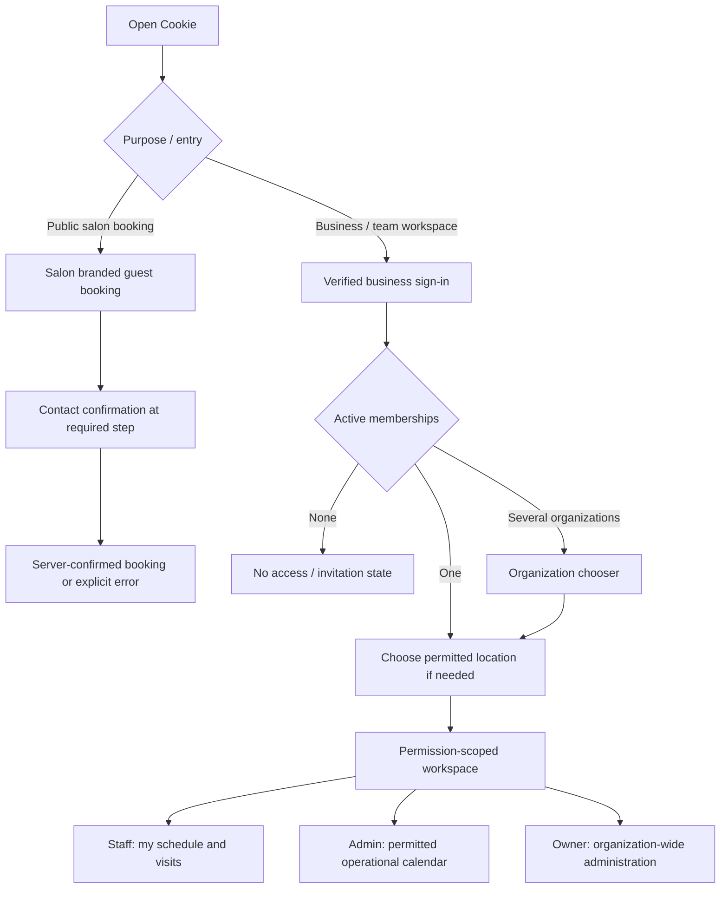

# Cookie — Role-aware entry, workspace navigation and permission UX

**Design iteration:** 03 · **Date:** 2026-11-16 · **Status:** PROPOSED UX SPECIFICATION (not auth implementation, not sign-off).  
**Objective:** Users must immediately understand whether they are booking as a guest, managing a business or working as a staff member, without exposure to an unauthorized surface.  
**Current baseline:** F1 synthetic Svelte demo is a single owner-like workspace; public booking currently shares demo state. Real web login, role-based UI session and owner management are **NOT implemented**; backend identity/policy modules only partially support end-to-end authorization.

## Approved constraints to preserve

- ADR-0004 ACCEPTED: Identity vs Membership vs Customer vs StaffProfile are distinct entities; one person may have multiple Organization memberships and roles, each with a possible Location scope.
- Organization is the data isolation boundary. Location is not a different tenant. Displayed role name and staff job title **never grant authority**; server permission codes, resource ownership, tenant and Location scopes decide.
- Staff sees only own permitted bookings and booking-linked customers; contact phone, visit history and notes must be separately authorized and field-filtered by backend.
- Public booking must support contact verification via phone or Telegram without mandatory separate account registration. Management of a booking must use a scoped, verified proof/link, never a bare booking ID.
- Server has final authority for Booking/PriceQuote/Availability; no optimistic “confirmed” status, no client-side role change that bypasses a revoked permission.
- User-approved product identity: customer public page belongs to salon and keeps a discreet Cookie technology credit; business workspace identifies as Cookie and clearly shows current Organization/Location.

## Information architecture: two entry surfaces, multiple scoped roles

The owner/admin/staff blocks are **views into one tenant-permission-scoped workspace**; not separate identities or independent codebases. A person with simultaneous admin+staff access can choose a convenient workflow tab but not change server authority by toggling an “active role.”

## Screen contract

| Screen / entry | Primary user goal | Required information and affordances | Failure/empty state |
|---|---|---|---|
| Salon public page | Book an appointment without SaaS confusion | Brand name/logo/theme; service, allowed location/staff, date and slot; unambiguous price preview; subtle Cookie footer | No availability; 409 conflict; trial expired; network retry; no fake confirmation |
| Business sign-in | Enter own workspace securely | Sign-in method from accepted Identity architecture (verified phone or Telegram); privacy explanation; consistent return destination | Expired/invalid proof; cannot infer an account from a name/phone string |
| Organization chooser | Select which independent tenant to work with | Trusted membership-provided names only; last used optional; clear no-data policy on switch | No active membership; revoked org; invite state |
| Location selector | Scope current workspace to allowed branches | “Все доступные филиалы” only with server-granted scope, otherwise permitted Location choices | Selected branch no longer allowed → discard scoped data and reopen selector |
| Owner overview | Get operational and subscription context | Today, appointment workload, setup checklist, booking page, team, services, protected settings | No data, trial expired, permission changed |
| Admin calendar | Manage authorized bookings | Day/week, assigned locations, staff/time/resource columns, quick detail, allowed cancel/reschedule | 403 with source data cleared, 409 preserving previous booking, revoked-right recovery |
| Staff workspace | See own schedule, necessary customer info | “Мои визиты”, “Мой график”, permitted shift requests, service/location chip | No unassigned/customer details; no unauthorized bulk CRM |
| Access settings | Create/assign roles safely | Separate technical role type, editable display name, professional title, permissions and location scope; ownership transfer separate | Role label rename does not escalate, owner privileges cannot be synthesized |
| My profile | Find identity/current context and leave | Authenticated identity context, organizations, sign out/revoke local session, channel links | Session timeout and role changes invalidate restricted state |

**Design requirement:** owner permissions may show workspace-wide navigation, administrator shows only permitted operational actions, staff gets a simplified home. The UI must not flash a hidden screen before policy loads. Nav rendering is NOT an authorization check.

## Layout baseline

### Desktop (Svelte Business Workspace)

- Keep compact Cookie left rail and operational calendar grid.
- Workspace header starts with `Organization / Location` context selectors; account/avatar and access status on the right.
- Permission-based navigation groups: **Работа** (Обзор / Календарь / Мои визиты), **Управление** (Услуги / Команда / Графики / Филиалы / Оформление), **Настройки** (Доступ / Подписка / Экспорт). These are *product labels*, not approved permission codes.
- Staff role without administrative permissions should not see an empty admin navigation rail.

### Mobile

- Keep maximum four bottom destinations for the user's permitted high-frequency tasks (for staff: `Сегодня`, `Мои визиты`, `График`, `Ещё`; for admin/owner: `Обзор`, `Календарь`, `Запись` if permitted, `Ещё`).
- Organization/Location context must be visible and switchable without relying on desktop sidebar; menu sheet must indicate selected scope.
- Customer public Booking UI never shows staff/owner bottom navigation or business account controls.
- All permission recovery states and multi-line organization names remain readable at CSS 320/375 and keyboard zoom; do not introduce horizontal scrolling.

## Required interactive state transitions

1. **Authenticating:** neutral skeleton; never display protected old-tenant data during a new session or org switch.
2. **Loaded/authorized:** show only vetted module navigation and data; controls receive server-derived effective scope.
3. **Attempt denied (403):** keep contextual explanation `У вас больше нет доступа к этому действию`; discard sensitive stale result, remove denied action, refresh permitted nav; never claim cancellation/reschedule succeeded.
4. **Membership revoked mid-session:** neutral signed-out/no-access view and data purge, with a safe reauthentication path; do not keep cached customer names on screen.
5. **Location change:** clear old location's list/detail/selection/query cache; fetch permitted new scoped data; protect current unsaved forms with an explicit discard confirmation where necessary.
6. **Multi-role:** available actions derive from current trusted policy per tenant/location, not from a client-side “I am the admin” switch; a convenience view filter may change presentation only.
7. **Booking conflict:** show clear 409 reason, keep existing booking intact, suggest another time; no generic green “success” notice.
8. **No guest identity:** public browsing/selection can remain possible where policy allows; verification occurs before protected creation or own-booking management.

## UX acceptance fixtures (synthetic; not production identities)

- **Fixture A:** owner of Studio A, two branches → owner navigation and org-wide calendar only if backend grants.
- **Fixture B:** administrator of branch 1 → own authorized location only; no owner-only access or other-branch customers.
- **Fixture C:** master in branch 2 → own bookings, own accessible schedule; no other master CRM, phone/history/notes absent without dedicated permissions.
- **Fixture D:** one identity is administrator+staff in branch 1, only staff in branch 2 → branch selector updates effective nav; moving branch cannot carry admin rights into branch 2.
- **Fixture E:** membership in two organizations → choose tenant; no cross-tenant cached booking or customer details.
- **Fixture F:** access revoked while editing a booking → server prevents commit or serializes authorization according to Issue #113; UI presents denied/recoverable state, never optimistic success.
- **Fixture G:** guest uses verified scoped link to manage own appointment → another booking ID must not expose customer details.

These fixtures are **acceptance scenarios**. No claim of runtime PASS until exact API integration and negative browser/PG testing.

## Implementation handoff order (without changing backend contracts)

1. **FE + Identity team:** agree real session state, trusted tenant + scope shape, auth status and denied/revoked error taxonomy as part of Issue #66; do not invent JSON fields from design.
2. **Design:** high-fidelity screens for sign-in / choose-org / choose-location / staff today / permission denied, with desktop/mobile responsive specs and empty/error states.
3. **FE:** implement presentation-only skeleton and conditional navigation after agreed transport, using a separated gateway/adapter. Keep test-only mock scenarios visibly synthetic.
4. **QA:** negative coverage for multi-tenancy, multi-role location drift, IDOR and concurrent permission revocation (#113). Require the backend gates to be green before interpreting the client as secure.
5. **Pilot gate:** physical devices, keyboard and screen-reader review, plus owner/administrator/staff task usability. Production rollout remains disallowed without explicit owner authorization.

## Explicit non-goals for this design iteration

- No production login, identity provider, OAuth/Telegram exchange, password/OTP handling, private API wire contract, role assignment mutation or role-permission enforcement is introduced here.
- No treatment of an admin/staff design variant as **working authorization**. The existing F1 UI still has no real login.
- No completion checkmark for #66/#113/#23 from the existence of these documents.

## Source references

- [ADR-0004 — Identity/Tenancy](../architecture/ADR-0004-identity-tenancy.md)
- [Organizations / Locations / Roles](../architecture/organization-location-and-access.md)
- [F0 implementation screen map](../architecture/f0-implementation-blueprint.md#5-screen-map--готовый-документальный-набросок-не-дизайн-макеты)
- [Frontend adapter contract, #66](https://github.com/tim8es/cookie/issues/66)
- [Role Security blocker, #113](https://github.com/tim8es/cookie/issues/113)
- [Business Workspace, #26](https://github.com/tim8es/cookie/issues/26)
